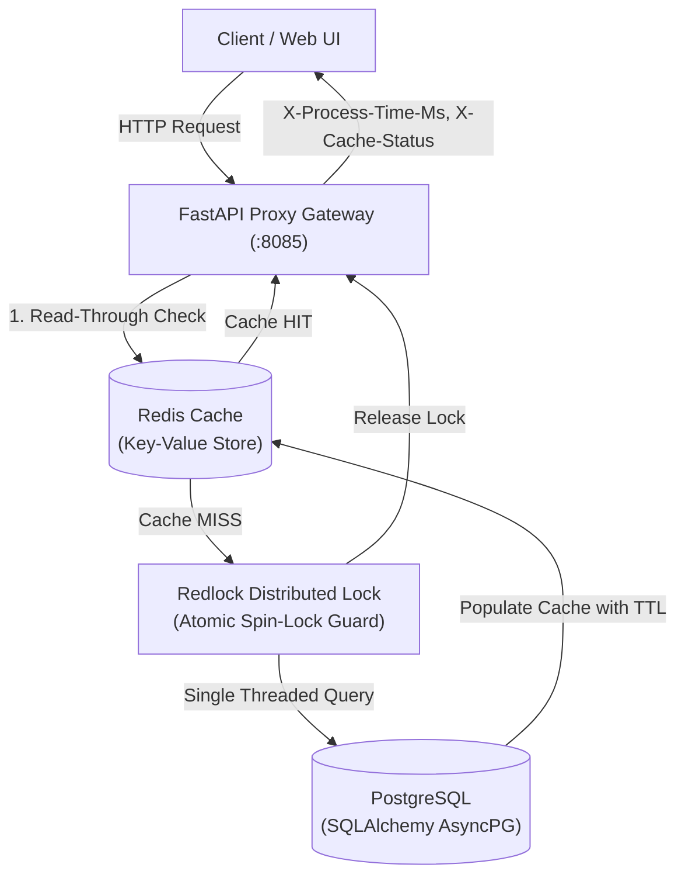

# Onchain: Enterprise Caching Proxy & Data Access Layer (DAL)

Onchain is a high-throughput, resilient caching proxy and asynchronous Data Access Layer implemented in **Python 3.13**, **FastAPI**, **Redis**, and **SQLAlchemy 2.0 (asyncio)** with **PostgreSQL**.

---

## ⚡ Architecture & Caching Design



---

## Core Capabilities

1. **Read-Through Caching**:
   - Automatically checks Redis before hitting the relational database.
   - Cache misses trigger transparent database lookups, populating the cache with configurable TTLs.

2. **Write-Through Caching**:
   - `POST /api/v1/accounts`, `PUT /api/v1/accounts/{address}`: Mutations persist to the database and atomically update the Redis cache under distributed lock protection.

3. **Redlock Distributed Stampede Protection**:
   - Eliminates the *Thundering Herd / Cache Stampede* problem.
   - When cache expires under 1,000 concurrent requests, a distributed atomic lock (`SET ... NX PX ...` with Lua token validation) ensures **only a single worker queries PostgreSQL**, while other threads wait on a non-blocking spin-lock.

4. **Structured JSON Logging & Telemetry Headers**:
   - Every response provides `X-Process-Time-Ms`, `X-Correlation-ID`, `X-Cache-Status` (`HIT`, `MISS`, `WRITE_THROUGH`), and `X-Data-Source`.

5. **Pytest & Testcontainers Integration**:
   - Comprehensive test suite covering read-through semantics, write-through mutations, Redlock mutual exclusion, and concurrent cache stampede prevention.
   - Includes real container integration tests using `testcontainers`.

---

## Quickstart

### Local Development

```bash
# 1. Activate environment
.\.venv\Scripts\activate

# 2. Run API server
uvicorn app.main:app --host 0.0.0.0 --port 8085 --reload
```

Interactive UI available at: `http://localhost:8085/`
Swagger API documentation: `http://localhost:8085/docs`

### Docker Compose

```bash
docker-compose up --build
```

---

## Running Automated Tests

```bash
pytest tests/ -v
```
All tests execute with sub-second in-memory isolation.
